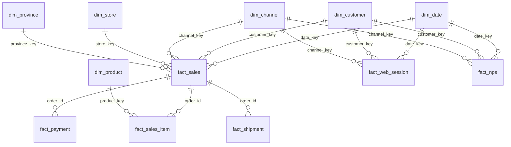

# EcoBottle AR · Data warehouse y tablero comercial

Trabajo práctico de **Introducción al Marketing Online y los Negocios Digitales** (Licenciatura en Ciencia de Datos, Universidad Austral).

Mini-ecosistema de datos comercial (online + offline) de **EcoBottle AR**: a partir de las tablas normalizadas del sistema de ventas (`raw/`) se construye un **data warehouse con modelo estrella de Kimball** (`dw/`) usando **SQL y DuckDB**, y un **tablero interactivo** publicado con **GitHub Pages** que muestra los KPIs pedidos: Ventas, Usuarios Activos, Ticket Promedio, NPS, Ventas por Provincia y Ranking Mensual por Producto.

**Tablero:** https://maitegomezgarin.github.io/repositorio-marketing/dashboard/

---

## Contenido

1. [Estructura del repositorio](#estructura-del-repositorio)
2. [Instrucciones de ejecución](#instrucciones-de-ejecución)
3. [Modelo estrella](#modelo-estrella)
4. [Diccionario de datos](#diccionario-de-datos)
5. [Supuestos](#supuestos)
6. [Consultas clave](#consultas-clave)
7. [Tablero](#tablero)
8. [Hallazgos](#hallazgos)

---

## Estructura del repositorio

```
raw/                  datos de origen: un CSV por tabla (no se modifican)
sql/
  01_dimensiones.sql  creación y carga de las dimensiones
  02_hechos.sql       creación y carga de las tablas de hechos (con FOREIGN KEY)
  03_consultas.sql    consultas de los KPIs y de las metas del trimestre
run_sql.py            ejecuta los archivos de sql/ en orden y genera el data warehouse
dw/                   data warehouse: un CSV por tabla + diagrama del modelo (modelo_estrella.md)
dashboard/            tablero web: index.html, styles.css y app.js
requirements.txt      dependencias de Python (DuckDB)
generator/            programa que generó los datos de raw/ (no se usa en el trabajo)
assets/               diagrama de las tablas de origen (DER)
```

El proceso es un ETL: se **extraen** los CSV de `raw/`, se **transforman** con SQL en DuckDB (`sql/`) y se **cargan** en el data warehouse (`dw/`), que es la fuente del tablero.

---

## Instrucciones de ejecución

Requisitos: **Python 3.9 o superior** y **Git**.

### 1. Clonar el repositorio y crear el entorno virtual

```bash
git clone https://github.com/maitegomezgarin/repositorio-marketing.git
cd repositorio-marketing
python3 -m venv .venv
```

Activar el entorno virtual:

- **Mac / Linux:** `source .venv/bin/activate`
- **Windows:** `.venv\Scripts\activate`

Instalar las dependencias:

```bash
python3 -m pip install -r requirements.txt
```

### 2. Armar el data warehouse

```bash
python3 run_sql.py
```

Este comando:

1. crea la base `warehouse.duckdb` desde cero;
2. ejecuta en orden `sql/01_dimensiones.sql`, `sql/02_hechos.sql` y `sql/03_consultas.sql`, y muestra en la terminal el resultado de cada consulta;
3. exporta cada tabla a `dw/<tabla>.csv`;
4. genera el diagrama del modelo en `dw/modelo_estrella.md`.

Otras opciones:

- `python3 run_sql.py --explorar`: abre DuckDB en el navegador con las tablas de origen (`raw.<tabla>`), sin ejecutar `sql/`.
- `python3 run_sql.py --ui`: arma el data warehouse y lo abre en el navegador.

### 3. Ver el tablero

**Publicado:** https://maitegomezgarin.github.io/repositorio-marketing/dashboard/

**En la computadora**, desde la carpeta del repositorio:

```bash
python3 -m http.server 8000
```

y abrir `http://localhost:8000/dashboard/`. Hace falta el servidor porque el navegador no permite que una página abierta como archivo lea los CSV de `dw/`. Para detenerlo: `Control + C`.

---

## Modelo estrella

El data warehouse sigue el enfoque de **Kimball**: cada tabla de hechos, junto con sus dimensiones, forma un **data mart** orientado a un proceso de negocio, y el data warehouse es la unión de esos data marts. Se integran mediante **dimensiones conformadas** (`dim_date`, `dim_customer`, `dim_channel` y `dim_province`), que son las mismas en todos los hechos.

| Data mart | Tabla de hechos | Grano (una fila =) | Dimensiones |
|---|---|---|---|
| Ventas | `fact_sales` | un pedido | fecha, cliente, canal, tienda, provincia |
| Ventas por producto | `fact_sales_item` | un producto dentro de un pedido | fecha, cliente, canal, tienda, provincia, producto |
| Actividad web | `fact_web_session` | una visita a la web | fecha, cliente, canal |
| Satisfacción | `fact_nps` | una respuesta a la encuesta NPS | fecha, cliente, canal |
| Logística | `fact_shipment` | un envío por correo | fecha, cliente, canal, tienda, provincia |
| Cobros | `fact_payment` | un pago | fecha, cliente, canal, tienda, provincia |

Las 13 tablas de origen quedan representadas: `channel`, `province`, `store`, `customer` y `product` (con `product_category`) en dimensiones; `address` para resolver la provincia y la ciudad; y `sales_order`, `sales_order_item`, `payment`, `shipment`, `web_session` y `nps_response` en hechos.



El diagrama resume las relaciones principales. `fact_sales_item`, `fact_payment` y `fact_shipment` también tienen FOREIGN KEY directas a fecha, cliente, canal, tienda y provincia. El diagrama completo, con todas las columnas, lo genera `run_sql.py` en [`dw/modelo_estrella.md`](dw/modelo_estrella.md).

---

## Diccionario de datos

Convenciones:

- **PK**: clave primaria. **FK**: clave foránea (`REFERENCES`).
- `*_key` es la **clave subrogada**, propia del data warehouse (generada con `ROW_NUMBER()`); `*_id` es la **clave natural**, que viene del sistema de origen.
- Montos en **pesos argentinos (ARS)**. Fechas y horas en hora de Argentina.
- `date_key` tiene el formato `AAAAMMDD` (por ejemplo, `20240131`).
- "Puede ser vacío" significa que la columna admite `NULL`.

### Dimensiones

#### `dim_date` — 639 filas

Un día por fila, del 01/01/2024 al 30/09/2025 (366 días de 2024 + 273 de 2025). Se genera con `range()`; no sale de un CSV.

| Columna | Tipo | Clave | Descripción / dominio |
|---|---|---|---|
| `date_key` | INTEGER | PK | Fecha en formato `AAAAMMDD` |
| `date` | DATE | | Fecha |
| `year` | INTEGER | | 2024 o 2025 |
| `quarter` | INTEGER | | Trimestre: 1 a 4 |
| `month` | INTEGER | | Mes: 1 a 12 |
| `month_name` | VARCHAR | | Enero … Diciembre |
| `year_month` | VARCHAR | | `AAAA-MM`, para agrupar por mes |
| `day` | INTEGER | | Día del mes: 1 a 31 |
| `day_of_week` | INTEGER | | 1 = lunes … 7 = domingo |
| `day_name` | VARCHAR | | Lunes … Domingo |
| `is_weekend` | BOOLEAN | | `TRUE` si es sábado o domingo |

#### `dim_channel` — 2 filas

Origen: `raw.channel`.

| Columna | Tipo | Clave | Descripción / dominio |
|---|---|---|---|
| `channel_key` | INTEGER | PK | Clave subrogada |
| `channel_id` | INTEGER | | Clave natural |
| `code` | VARCHAR | | `ONLINE` (web) / `OFFLINE` (tiendas físicas) |
| `name` | VARCHAR | | Tienda Online / Tiendas Físicas |

#### `dim_province` — 4 filas

Origen: `raw.province`.

| Columna | Tipo | Clave | Descripción / dominio |
|---|---|---|---|
| `province_key` | INTEGER | PK | Clave subrogada |
| `province_id` | INTEGER | | Clave natural |
| `name` | VARCHAR | | Buenos Aires, Córdoba, Santa Fe, Mendoza |
| `code` | VARCHAR | | BA, CBA, SF, MZA |

#### `dim_product` — 2 filas

Origen: `raw.product` + `raw.product_category`. La jerarquía de categorías (padre-hijo) se "aplana": cada producto queda con su categoría y su familia.

| Columna | Tipo | Clave | Descripción / dominio |
|---|---|---|---|
| `product_key` | INTEGER | PK | Clave subrogada |
| `product_id` | INTEGER | | Clave natural |
| `sku` | VARCHAR | | ECO-CLASSIC-A / ECO-SPORT-B |
| `name` | VARCHAR | | Classic A Bottle / Sport B Bottle |
| `category` | VARCHAR | | Classic / Sport |
| `family` | VARCHAR | | Bottles (categoría padre) |
| `list_price` | DECIMAL(12,2) | | Precio de lista sin IVA: $12.000 / $15.000 |

#### `dim_store` — 4 filas

Origen: `raw.store` + `raw.address` + `raw.province`. Cada tienda queda con su ciudad y su provincia.

| Columna | Tipo | Clave | Descripción / dominio |
|---|---|---|---|
| `store_key` | INTEGER | PK | Clave subrogada |
| `store_id` | INTEGER | | Clave natural |
| `name` | VARCHAR | | Tienda BA, Tienda CBA, Tienda SF, Tienda MZA |
| `city` | VARCHAR | | La Plata, Córdoba, Rosario, Mendoza |
| `province_name` | VARCHAR | | Provincia de la tienda |

#### `dim_customer` — 3.472 filas

Origen: `raw.customer` (3.471 clientes) + una fila **"Desconocido"** con clave `-1` para las sesiones web y respuestas NPS anónimas.

| Columna | Tipo | Clave | Descripción / dominio |
|---|---|---|---|
| `customer_key` | INTEGER | PK | Clave subrogada; `-1` = Desconocido |
| `customer_id` | INTEGER | | Clave natural; vacío en la fila Desconocido |
| `first_name` | VARCHAR | | Nombre |
| `last_name` | VARCHAR | | Apellido |
| `full_name` | VARCHAR | | Nombre y apellido; "Desconocido" en la fila `-1` |
| `status` | VARCHAR | | `A` = activo, `I` = dio de baja su cuenta |
| `created_at` | TIMESTAMP | | Fecha de alta |

### Hechos

#### `fact_sales` — 11.969 filas · grano: un pedido

Origen: `raw.sales_order` + `raw.address`. Fuente de Ventas, Ticket Promedio y Ventas por Provincia. Incluye todos los pedidos; `is_sale` indica cuáles cuentan como venta.

| Columna | Tipo | Clave | Descripción / dominio |
|---|---|---|---|
| `order_id` | BIGINT | PK | Número de pedido |
| `date_key` | INTEGER | FK → `dim_date` | Fecha del pedido |
| `customer_key` | INTEGER | FK → `dim_customer` | Cliente |
| `channel_key` | INTEGER | FK → `dim_channel` | Canal |
| `store_key` | INTEGER | FK → `dim_store` | Tienda; vacío en pedidos ONLINE |
| `province_key` | INTEGER | FK → `dim_province` | Provincia de la dirección de envío |
| `order_date` | TIMESTAMP | | Fecha y hora del pedido |
| `status` | VARCHAR | | `CREATED`, `PAID`, `FULFILLED`, `CANCELLED`, `REFUNDED` |
| `is_sale` | BOOLEAN | | `TRUE` si `status` es `PAID` o `FULFILLED` |
| `subtotal` | DECIMAL(12,2) | | Suma de `line_total` del pedido |
| `tax_amount` | DECIMAL(12,2) | | IVA: 21 % del subtotal |
| `shipping_fee` | DECIMAL(12,2) | | Costo de envío |
| `total_amount` | DECIMAL(12,2) | | `subtotal + tax_amount + shipping_fee` |

#### `fact_sales_item` — 14.573 filas · grano: un producto dentro de un pedido

Origen: `raw.sales_order_item`, con las claves del pedido tomadas de `fact_sales`. Fuente del Ranking Mensual por Producto.

| Columna | Tipo | Clave | Descripción / dominio |
|---|---|---|---|
| `order_item_id` | BIGINT | PK | Línea del pedido |
| `order_id` | BIGINT | FK → `fact_sales` | Pedido al que pertenece |
| `date_key` | INTEGER | FK → `dim_date` | Fecha del pedido |
| `customer_key` | INTEGER | FK → `dim_customer` | Cliente |
| `channel_key` | INTEGER | FK → `dim_channel` | Canal |
| `store_key` | INTEGER | FK → `dim_store` | Tienda; vacío en pedidos ONLINE |
| `province_key` | INTEGER | FK → `dim_province` | Provincia de envío del pedido |
| `product_key` | INTEGER | FK → `dim_product` | Producto |
| `status` | VARCHAR | | Estado del pedido |
| `is_sale` | BOOLEAN | | `TRUE` si el pedido es `PAID` o `FULFILLED` |
| `quantity` | INTEGER | | Cantidad (mayor a 0) |
| `unit_price` | DECIMAL(12,2) | | Precio unitario sin IVA |
| `discount_amount` | DECIMAL(12,2) | | Descuento |
| `line_total` | DECIMAL(12,2) | | `quantity × unit_price − discount_amount` |

#### `fact_web_session` — 100.363 filas · grano: una visita a la web

Origen: `raw.web_session`. Fuente de Usuarios Activos.

| Columna | Tipo | Clave | Descripción / dominio |
|---|---|---|---|
| `session_id` | BIGINT | PK | Sesión |
| `date_key` | INTEGER | FK → `dim_date` | Fecha de inicio |
| `customer_key` | INTEGER | FK → `dim_customer` | Cliente; `-1` si es anónima |
| `channel_key` | INTEGER | FK → `dim_channel` | Siempre ONLINE |
| `started_at` | TIMESTAMP | | Inicio de la sesión |
| `ended_at` | TIMESTAMP | | Fin de la sesión; puede ser vacío |
| `source` | VARCHAR | | `ads` (redes), `direct`, `referral`, `organic` (buscadores) |
| `device` | VARCHAR | | `mobile`, `desktop`, `tablet` |
| `is_anonymous` | BOOLEAN | | `TRUE` si el visitante no inició sesión |
| `active_user_id` | VARCHAR | | `C-<customer_id>` o `S-<session_id>` si es anónima |
| `duration_seconds` | INTEGER | | Duración; vacío si no hay `ended_at` |

#### `fact_nps` — 3.083 filas · grano: una respuesta a la encuesta

Origen: `raw.nps_response`. Fuente del NPS. La encuesta no tiene número de pedido: se relaciona por cliente y canal.

| Columna | Tipo | Clave | Descripción / dominio |
|---|---|---|---|
| `nps_id` | BIGINT | PK | Respuesta |
| `date_key` | INTEGER | FK → `dim_date` | Fecha de respuesta |
| `customer_key` | INTEGER | FK → `dim_customer` | Cliente; `-1` si es anónima |
| `channel_key` | INTEGER | FK → `dim_channel` | Canal |
| `responded_at` | TIMESTAMP | | Fecha y hora de respuesta |
| `score` | INTEGER | | Puntaje: 0 a 10 |
| `nps_category` | VARCHAR | | `Promotor` (9-10), `Pasivo` (7-8), `Detractor` (0-6) |
| `nps_value` | INTEGER | | `100`, `0` o `-100` según la categoría |
| `comment` | VARCHAR | | Comentario; puede ser vacío |

#### `fact_shipment` — 7.009 filas · grano: un envío por correo

Origen: `raw.shipment`, con las claves del pedido tomadas de `fact_sales`. Fuente de los tiempos de entrega.

| Columna | Tipo | Clave | Descripción / dominio |
|---|---|---|---|
| `shipment_id` | BIGINT | PK | Envío |
| `order_id` | BIGINT | FK → `fact_sales` | Pedido |
| `date_key` | INTEGER | FK → `dim_date` | Fecha del pedido |
| `customer_key` | INTEGER | FK → `dim_customer` | Cliente |
| `channel_key` | INTEGER | FK → `dim_channel` | Canal |
| `store_key` | INTEGER | FK → `dim_store` | Tienda que envió; vacío en pedidos ONLINE |
| `province_key` | INTEGER | FK → `dim_province` | Provincia de destino |
| `carrier` | VARCHAR | | Correo Argentino |
| `tracking_number` | VARCHAR | | Número de seguimiento; puede ser vacío |
| `status` | VARCHAR | | `READY`, `SHIPPED`, `DELIVERED`, `CANCELLED` |
| `order_date` | TIMESTAMP | | Fecha del pedido |
| `shipped_at` | TIMESTAMP | | Despacho; puede ser vacío |
| `delivered_at` | TIMESTAMP | | Entrega; puede ser vacío |
| `days_in_transit` | DECIMAL(6,2) | | Días del despacho a la entrega |
| `days_to_delivery` | DECIMAL(6,2) | | Días de la compra a la entrega |

#### `fact_payment` — 11.969 filas · grano: un pago

Origen: `raw.payment`, con las claves del pedido tomadas de `fact_sales`. Permite conciliar ventas y pagos.

| Columna | Tipo | Clave | Descripción / dominio |
|---|---|---|---|
| `payment_id` | BIGINT | PK | Pago |
| `order_id` | BIGINT | FK → `fact_sales` | Pedido |
| `date_key` | INTEGER | FK → `dim_date` | Fecha del pedido |
| `customer_key` | INTEGER | FK → `dim_customer` | Cliente |
| `channel_key` | INTEGER | FK → `dim_channel` | Canal |
| `store_key` | INTEGER | FK → `dim_store` | Tienda; vacío en pedidos ONLINE |
| `province_key` | INTEGER | FK → `dim_province` | Provincia de envío del pedido |
| `method` | VARCHAR | | `CARD`, `CASH`, `TRANSFER`, `GATEWAY` (Mercado Pago) |
| `status` | VARCHAR | | `PENDING`, `PAID`, `FAILED`, `REFUNDED` |
| `is_collected` | BOOLEAN | | `TRUE` si `status` es `PAID` |
| `paid_at` | TIMESTAMP | | Fecha de cobro; vacío si no se cobró |
| `transaction_ref` | VARCHAR | | Referencia de la transacción |
| `amount` | DECIMAL(12,2) | | Monto del pago |

---

## Supuestos

**Ventas y pedidos**

- Un pedido cuenta como venta si su estado es `PAID` o `FULFILLED` (`is_sale = TRUE`). `CREATED`, `CANCELLED` y `REFUNDED` no cuentan. Los hechos guardan todos los pedidos, para poder analizar también los cancelados y devueltos.
- Ventas y Ticket Promedio usan `total_amount`, que incluye IVA y envío. El Ranking por Producto usa `line_total`, que no incluye IVA ni envío, como define la consigna.
- Ventas y Ticket Promedio se calculan sobre `fact_sales` (un pedido por fila) para que `total_amount` no se repita en los pedidos con más de un producto.
- La provincia de un pedido es la de su dirección de envío (`shipping_address_id`). En las compras en tienda es la dirección de la tienda, así que todos los pedidos tienen provincia.
- La fecha de los pagos y envíos (`date_key`) es la fecha del pedido, para poder compararlos con las ventas del mismo período.

**Clientes y anónimos**

- Las sesiones web y las respuestas NPS sin cliente se asignan a la fila "Desconocido" (`customer_key = -1`) para no perderlas.
- Usuarios Activos se calcula como `COUNT(DISTINCT customer_id)`, o `session_id` si la visita es anónima, como define la consigna. Para contarlo con una sola columna, `active_user_id` vale `C-<customer_id>` o `S-<session_id>`.
- Los clientes que dieron de baja su cuenta (`status = 'I'`) se mantienen, porque sus compras anteriores siguen siendo válidas.
- `dim_customer` no incluye email ni teléfono: son datos personales que el análisis no necesita.
- Todas las sesiones web pertenecen al canal ONLINE.

**NPS y envíos**

- NPS = (% de puntajes 9-10 − % de puntajes 0-6) × 100. Es igual al promedio de `nps_value`, lo que permite calcularlo con cualquier filtro.
- Los tiempos de entrega solo existen para los envíos `DELIVERED`.

**Metas del trimestre**

- "Crecer 15 % las ventas en Córdoba" se mide como la variación de las ventas de cada trimestre contra el trimestre anterior.
- "Reducir los tiempos de entrega en Mendoza" se mide con los días promedio de la compra a la entrega (`days_to_delivery`), por trimestre.

**Tablero**

- El tablero se hizo como sitio web con GitHub Pages (HTML, CSS y JavaScript) en lugar de Looker Studio, por indicación del docente. Lee los CSV de `dw/` y calcula los KPIs con las mismas definiciones de `sql/03_consultas.sql`.
- Cada filtro se aplica solo a las vistas que tienen esa dimensión: las visitas web y el NPS no tienen provincia ni producto, y el producto solo está en el detalle de los pedidos. Cada vista indica qué filtros le afectan.

---

## Consultas clave

Todas están en [`sql/03_consultas.sql`](sql/03_consultas.sql) y se ejecutan con `python3 run_sql.py`. Resultados para todo el período (01/01/2024 al 30/09/2025):

| KPI | Resultado |
|---|---|
| Total Ventas | $382.410.636 (10.998 pedidos) |
| Usuarios Activos | 73.828 |
| Ticket Promedio | $34.770,93 (ONLINE $35.152,08 · OFFLINE $34.228,75) |
| NPS | 30,0 (ONLINE 24,01 · OFFLINE 40,93) |
| Ventas por Provincia | Buenos Aires 37,3 % · Córdoba 23,4 % · Santa Fe 22,9 % · Mendoza 16,4 % |

**Total Ventas**

```sql
SELECT SUM(total_amount) AS total_ventas
FROM fact_sales
WHERE is_sale;
```

**Usuarios Activos por mes**

```sql
SELECT d.year_month, COUNT(DISTINCT w.active_user_id) AS usuarios_activos
FROM fact_web_session AS w
JOIN dim_date AS d ON d.date_key = w.date_key
GROUP BY d.year_month
ORDER BY d.year_month;
```

**Ticket Promedio**

```sql
SELECT ROUND(SUM(total_amount) / COUNT(*), 2) AS ticket_promedio
FROM fact_sales
WHERE is_sale;
```

**NPS por canal**

```sql
SELECT c.code AS canal,
       ROUND(100.0 * COUNT(*) FILTER (WHERE n.score >= 9) / COUNT(*)
           - 100.0 * COUNT(*) FILTER (WHERE n.score <= 6) / COUNT(*), 2) AS nps
FROM fact_nps AS n
JOIN dim_channel AS c ON c.channel_key = n.channel_key
GROUP BY c.code;
```

**Ventas por Provincia**

```sql
SELECT p.name AS provincia, SUM(f.total_amount) AS ventas
FROM fact_sales AS f
JOIN dim_province AS p ON p.province_key = f.province_key
WHERE f.is_sale
GROUP BY p.name
ORDER BY ventas DESC;
```

**Ranking mensual por producto**

```sql
SELECT d.year_month, p.name AS producto, SUM(i.line_total) AS ventas,
       RANK() OVER (PARTITION BY d.year_month ORDER BY SUM(i.line_total) DESC) AS ranking
FROM fact_sales_item AS i
JOIN dim_date    AS d ON d.date_key    = i.date_key
JOIN dim_product AS p ON p.product_key = i.product_key
WHERE i.is_sale
GROUP BY d.year_month, p.name
ORDER BY d.year_month, ranking;
```

`sql/03_consultas.sql` también incluye las ventas por mes y canal, y las consultas de las dos metas del trimestre.

---

## Tablero

**Enlace:** https://maitegomezgarin.github.io/repositorio-marketing/dashboard/

| Pedido por la consigna | Cómo está en el tablero |
|---|---|
| Filtros: fecha, canal, provincia y producto | Barra de filtros fija arriba (desde/hasta, canal, provincia, producto) y botón para limpiarlos |
| Ventas (serie temporal y tarjeta $M) | Tarjeta "Total Ventas" y gráfico de líneas de ventas por mes y canal |
| Usuarios Activos (serie temporal y tarjeta nK) | Tarjeta "Usuarios Activos" y gráfico de usuarios activos por mes |
| Ticket Promedio ($K) | Tarjeta "Ticket Promedio" |
| NPS (tarjeta y tendencia) | Tarjeta "NPS" (con promotores y detractores) y gráfico de tendencia mensual |
| Ventas por Provincia (mapa o barra) | Gráfico de barras, con la provincia filtrada resaltada |
| Ranking mensual por Producto (top N) | Tabla por mes con selector Top N |

Además, el tablero muestra las **metas del trimestre** del caso de uso: las ventas trimestrales de Córdoba con su variación (resaltando si se alcanzó el +15 %) y los días de entrega en Mendoza comparados con el resto de las provincias.

---

## Hallazgos

- **Canales:** ONLINE genera el 59,4 % de las ventas ($227,0 M) y OFFLINE el 40,6 % ($155,4 M). El ticket promedio es similar en los dos canales (cerca de $35 K).
- **Estacionalidad:** diciembre de 2024 es el mes de mayores ventas ($28,4 M), con un pico en los dos canales y en los usuarios activos.
- **Productos:** Sport B genera más ingresos ($162,7 M contra $147,2 M de Classic A), aunque Classic A vende más unidades (12.498 contra 11.047). Los dos se alternan el primer puesto del ranking mensual.
- **Satisfacción:** el NPS de las tiendas físicas (40,9) es muy superior al de la tienda online (24,0). En el tercer trimestre de 2024 el NPS online cayó a −10,3, en el mismo trimestre en que el tiempo promedio de entrega subió a 7,4 días (en el resto del período estuvo entre 4,5 y 5,5). Los datos no prueban que una cosa cause la otra, pero la coincidencia sugiere que la logística afecta la satisfacción online.
- **Meta Córdoba:** solo el cuarto trimestre de 2024 superó el +15 % (+54,0 %). Los tres trimestres de 2025 cayeron contra el trimestre anterior (el último, −5,3 %), así que la meta no se está cumpliendo.
- **Meta Mendoza:** los días de la compra a la entrega en Mendoza bajaron de 8,1 en el tercer trimestre de 2024 a 5,3 en el tercer trimestre de 2025. En todo el período, Mendoza (5,7 días) está por debajo de Santa Fe (5,8) y Córdoba (6,0), pero lejos de Buenos Aires (4,0).
- **Medios de pago:** el 55,1 % de los pagos cobrados son con tarjeta y el 24,3 % con Mercado Pago (`GATEWAY`).
- **Tráfico web:** el 70,5 % de las visitas son anónimas. Por origen: `direct` 30,4 %, `organic` 26,3 %, `ads` 25,1 % y `referral` 18,2 %.

---

## Buenas prácticas

- **Entorno virtual** (`.venv`) con las dependencias en `requirements.txt`.
- **Conventional commits** (`feat(sql): ...`, `feat(dw): ...`, `feat(dashboard): ...`, `docs: ...`).
- Toda la gestión del repositorio con la **consola** (`git add`, `git commit`, `git push`).
- Los datos de origen (`raw/`) no se modifican: el data warehouse se regenera completo con `python3 run_sql.py`.